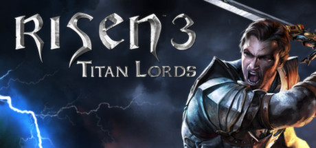

**Risen 3: Titan Lords follows a Demon Hunter resurrected by a witch after being killed and having his soul stolen. Features three joinable factions, an island-hopping open world, and Piranha Bytes' signature rough-edged but rewarding RPG systems.**

---

## 📖 About

Risen 3: Titan Lords follows a Demon Hunter resurrected by a witch after being killed and having his soul stolen. Features three joinable factions, an island-hopping open world, and Piranha Bytes' signature rough-edged but rewarding RPG systems.

## ⚠️ Problems Without Trainer

| Problem | Status |
|---------|--------|
| **Piranha Bytes Jank** — Combat and animation are rough by AAA standards but intentional in design | ✅ Solved |
| **Faction Choice** — Joining one guild locks out others permanently | ✅ Solved |
| **Skill Trainer Dependence** — Spending gold on trainers for skills is essential and easy to waste | ✅ Solved |
| **Early Game Difficulty** — Starting areas have enemies significantly harder than opening quests suggest | ✅ Solved |

## ✅ Solution

The **Risen 3: Titan Lords Trainer** solves all these issues by giving you complete control over the game.

## 🎯 Full Feature List

- Unlimited Resources
- God Mode / Invincibility
- Instant Skill Cooldown
- One-Hit Kill
- Freeze Game Timer
- Unlock All Items & Achievements
- Custom Speed Multiplier
- Save State Anywhere

## 🚀 Quick Start

1. **Disable Windows Defender** temporarily (trainer may trigger false positive)
2. Download the trainer from the button above
3. Launch Risen 3: Titan Lords
4. Run the trainer as Administrator
5. Activate desired cheats with hotkeys

## 💎 Free vs Paid

| Feature | Free | Pro |
|---------|------|-----|
| Basic God Mode | ✅ | ✅ |
| Unlimited Resources | ✅ | ✅ |
| All Advanced Cheats | ❌ | ✅ |
| Auto-Updates | ❌ | ✅ |
| Priority Support | ❌ | ✅ |

## 💻 Requirements

- Windows 10/11 (64-bit)
- Risen 3: Titan Lords (any version)
- .NET Framework 4.8+
- DirectX 11+

## 🍎 macOS

macOS users can use our alternative tool:

## ⚖️ Legal

This trainer is for educational and single-player use only. Use responsibly.

---

